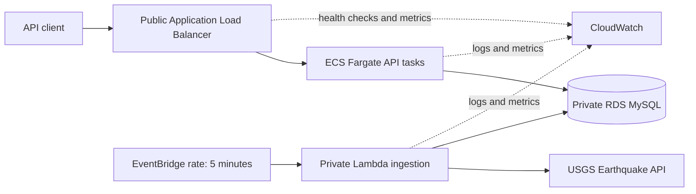

# Architecture and SRE Design

## Architecture Overview

The VPC has public subnets for the ALB and private subnets for ECS, Lambda, and RDS. Security groups allow traffic only along the required paths: the ALB can reach ECS on port 8080, and ECS or Lambda can reach RDS on port 3306. RDS is not publicly reachable. NAT gateways provide outbound access from private subnets to USGS, ECR, and AWS service endpoints.

ECS runs two Fargate tasks behind the ALB so one task can be replaced while the other continues serving traffic. RDS is deployed across private subnets in multiple Availability Zones. Terraform modules separate the network, security groups, database, compute, scheduling, and monitoring concerns.

## SLI, SLO, and Error Budget

The following service objectives are appropriate for this project:

| SLI | Measurement | SLO | Error budget |
| --- | --- | --- | --- |
| API availability | Successful HTTP responses from ALB health checks and endpoint probes divided by total probes | 99.9% per calendar month | 0.1%, or about 43 minutes 12 seconds per 30-day month |
| API latency | Percentage of Synthetic API checks completing within 2 seconds | 99% per calendar month | 1%, or about 7 hours 12 minutes per 30-day month |
| Ingestion freshness | Time between scheduled ingestion runs and the newest successfully stored USGS event | 99% of five-minute intervals have data no more than 15 minutes old | 1% of intervals, or about 7 hours 12 minutes per 30-day month |

For availability, the monthly error budget is calculated as `total minutes in the month * (1 - 0.999)`. For latency, an observation is an API check that exceeds the two-second threshold. For ingestion freshness, an observation is a five-minute schedule interval; the interval is an error when Lambda fails or the newest stored event is older than 15 minutes. Datadog Synthetic tests measure API availability and latency only. Lambda publishes `IngestionFreshnessSeconds` and `IngestionFreshnessBreached` to the `EarthquakeMonitor/SLI` CloudWatch namespace, and the AWS monitoring module alarms when freshness is breached. The current alarms also cover Lambda errors, ALB 5xx responses, and unhealthy targets.

When an error budget is nearly exhausted, pause risky changes, investigate the dominant failure mode, and prioritize reliability work. When it is depleted, freeze nonessential releases until the service returns within the SLO, complete a blameless incident review, and spend the next iteration on the identified reliability issue.

## Resilience and Toil Reduction

If USGS is unavailable, the Lambda invocation returns an error and does not replace existing database records. EventBridge continues scheduling future attempts, and the API can continue serving previously stored data while RDS and ECS remain healthy. Lambda and ALB failures are visible through CloudWatch alarms. The current design does not yet include a dead-letter queue or explicit stale-data response metadata; these are recommended production improvements.

Operational toil is reduced through Terraform modules, repeatable Lambda and Docker build scripts, EventBridge scheduling, ECS desired-count self-healing, ALB health checks, and CloudWatch dashboards and alarms. Account/profile switching and deployment verification commands are documented in the main README so routine releases do not depend on undocumented manual steps.

## Blameless Incident Response

1. Detect: acknowledge the CloudWatch alarm and record the incident start time and affected SLI.
2. Stabilize: check ALB health, ECS task logs, Lambda logs, RDS connectivity, and USGS availability; roll back the latest application image if it is the likely cause.
3. Communicate: state user impact, current mitigation, and the next update time without assigning blame.
4. Recover: confirm the SLO has recovered and verify both ingestion and API endpoints with real requests.
5. Learn: document the timeline, contributing conditions, and concrete follow-up actions with owners and due dates.

## Challenge Requirements Status

- Infrastructure requirements are implemented with Terraform using VPC public/private subnets, ECS/Fargate, Lambda, RDS MySQL, EventBridge, ALB, IAM, security groups, and CloudWatch.
- Weekly averages and historical search are implemented by `/quakes/weekly-average` and `/quakes/top`.
- The current `/quakes/latest` implementation returns all recent records from seven days. To match the challenge literally, it still needs to be changed to return only magnitude greater than 4.0 from the last 24 hours.
- A deployed API URL and repeatable deployment instructions are provided in the main README.
